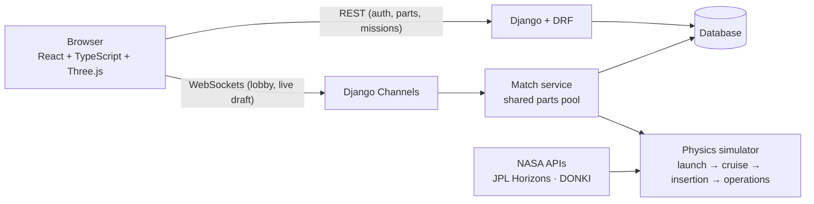

<div align="center">

# 🚀 The Space Race

### Draft a spacecraft against a rival. Fly it through live NASA data. Learn real mission engineering.

**NASA Space Apps Challenge 2026 · Challenge: _Space Mission Design Game_ · Team GENESIS Z**

[**▶ Play now**](https://space-game-ten-rho.vercel.app) · [🎬 30-second demo video](DEMO_30S_LINK) · [🎥 5-minute project & product video](PROJECT_5MIN_LINK) · [🔬 How we validate the physics](#-real-nasa-data-tested-physics)

</div>

---

## What is it?

**The Space Race** is a competitive browser game that teaches how real space missions are designed.

Two players get the **same mission** (for example *"Photograph Jezero Crater on Mars"*) and the **same budget**, then
draft spacecraft parts **live from one shared, limited pool**. If your rival grabs the light solar array, you fly the
heavy one, and that extra mass ripples through your rocket, Δv, power, thermal design and cost.

When both players hit **LAUNCH**, a physics simulator flies both probes through **today's real NASA conditions**
(planet positions, launch windows, space weather). Both players roll the **same dice**, so only engineering decides
who wins. Then a debrief explains every success and failure with the real equation and a real mission that hit the
same problem.

> *"Every kilogram on a spacecraft costs you three times over."* The game makes you feel it.

## 🎮 Game modes

| Mode | What you do |
|---|---|
| ⚔️ **Space Race (PvP)** | Same mission, same budget, one shared parts pool. Draft live against a friend, then launch. |
| 🤖 **Vs AI engineer** | A greedy AI drafts from the same pool and steals your last copies. |
| 🚙 **Rover Expedition** | Build a rover, then drive it in 3D on Mars, the Moon or Venus at real landing sites and real local solar time. Keyboard or touch. |
| 🛰️ **Solo lab** | Practise freely and take Mission Control physics challenges for extra budget. |
| 🏫 **Classroom mode** | A teacher shares a code: the whole class flies the same mission with the same NASA data and dice, on one leaderboard. |
| 🔬 **Science & data** | Every data source, and the model tested against published numbers. |

## 🧠 What players learn

- **Live flight-dynamics notebook:** every equation the simulator uses (rocket equation, launch margin, inverse-square
  solar power and radio link, battery depth of discharge, heat balance, cost) with *your* design's numbers plugged in.
  Key equations have **🎛 slider sandboxes**.
- **Mission Control challenges:** physics questions graded by the server. Each right answer adds **$10M** to your
  budget, so understanding the physics helps you win.
- **Flight director's debrief:** every failure names the equation and the fix, plus an *"it happened for real"* story:
  Akatsuki missing Venus orbit, Galileo's stuck antenna, Opportunity's last dust storm, Cassini's gravity assists…
- **Share cards:** a result image to challenge your friends ("I reached Mars with a 18% mass margin. Can you beat it?").

## 🛰️ Real NASA data, tested physics

| NASA source | What it drives in the game |
|---|---|
| [JPL Horizons API](https://ssd.jpl.nasa.gov/horizons/) | Live positions of Earth, Mars, Venus and the Moon: launch windows, departure energy (C3), light-time delay |
| [NASA DONKI](https://api.nasa.gov/) | Solar flares, CMEs and geomagnetic storms from the last 30 days: radiation risk and solar-array wear |
| [Mars24 (NASA GISS)](https://www.giss.nasa.gov/tools/mars24/) | Local solar time and Sun elevation at real rover landing sites |
| [NASA Planetary Fact Sheets](https://nssdc.gsfc.nasa.gov/planetary/factsheet/) | Gravity, sunlight and temperatures at each destination |
| [NASA Radioisotope Power Systems](https://science.nasa.gov/planetary-science/programs/radioisotope-power-systems/) | MMRTG power, mass and decay |

The simulator is tested against **21 published numbers**, including Falcon Heavy's 16,800 kg to Mars, the 259-day
Hohmann transfer to Mars, solar irradiance at Mars and Venus, Earth–Mars light time and Curiosity's MMRTG output
after 12 years. Each check is shown in-game with our value, the published value and the error, and is labelled as an
independent prediction, a calibration or input data.

## 🏗️ How it works



- **Frontend:** React, TypeScript, Vite, Three.js (3D menu, hangar, launch cinematic, rover), Web Audio sound effects.
- **Backend:** Python, Django, Django REST Framework, Django Channels (WebSockets), SQLite or PostgreSQL, Redis.
- **Fair play:** the server owns the shared pool (row-locked, so two players can't take the last part), grades the
  quiz, and gives both players the same random seed.
- **Hosting:** frontend on Vercel, backend on Render.

## 🚀 Run it locally

```bash
# 1. Backend
cd space-race/backend
pip install -r requirements.txt
python manage.py migrate
python manage.py seed_catalog
python manage.py runserver          # http://localhost:8000

# 2. Frontend (second terminal)
cd space-race/frontend
npm install
npm run dev                         # http://localhost:5173
```

To test PvP alone, open two browser windows (one normal, one incognito), log in as a guest in each and click
**Find a rival** in both. Full setup, the WebSocket protocol, Postgres/Redis and deployment are in
[`space-race/README.md`](space-race/README.md).

## 📁 Project structure

```
space-race/
├── backend/            Django project
│   └── game/           models, simulator (sim.py), NASA data (nasa.py), validation, quiz, WebSocket consumers
├── frontend/           React + Vite app
│   └── src/
│       ├── components/ menu, drafting board, equations notebook, 3D launch, results, share cards
│       ├── rover/      Rover Expedition: parts, terrain, 3D driving
│       └── three/      procedural 3D models and particle effects
├── PITCH.md            submission kit and demo script
└── README.md           full technical documentation
```

## ⚠️ Honest limitations

- Part prices marked "est." are our estimates; launch prices and some parts (HiRISE, MMRTG) are real figures.
- The thermal model is a lumped heat balance, and launch windows use Hohmann geometry rather than a full porkchop plot.
- Rover terrain is procedural, and rover energy runs faster than real time so a drive fits in 3 minutes.

## 🔭 Next steps

NASA Mars Trek and Moon Trek terrain for the rover · porkchop-plot trajectory picker · aerobraking and gravity
assists · teacher dashboard.

## 👩‍🚀 Team GENESIS Z

Built for the NASA Space Apps Challenge 2026.

We used an AI assistant (Claude, by Anthropic) as a coding and writing partner; the team designed the game, chose the
physics models, and reviewed, tested and fact-checked everything. The game's 3D art is drawn in code and its sounds
are synthesized in the browser: no AI-generated images.
